 

---

## 🚀 Projects

### 🏦 Payments & Remittance
| Project | What it does | Stack |
|---------|--------------|-------|
| [**AutoRamp**](https://autoramp.thebuidl.org) | Live NGN on/off-ramp & swap — **≈ NGN 70M processed**, settlement on Base | NestJS · Next.js · Base |
| [**Looprail**](https://looprail.xyz) | Stablecoin remittance for African diaspora — on the Play Store (KE, TZ, NG off-ramps) | Go · Redis Streams · CCTP |

### 🤖 AI Agents
| Project | What it does | Stack |
|---------|--------------|-------|
| [**BlindMarket**](https://blindmarket.xyz) | Encrypted agent-to-agent task marketplace — AES-256 briefs, on-chain escrow, TEE-verified | TypeScript · 0G · Sui |
| [**Among Agents**](https://among-agents-base.vercel.app) | On-chain social deduction — agents join, compete & auto-start games on Base | TypeScript · Base |
| [**Promus**](https://github.com/JemIIahh/promus) | Sovereign agent runtime — ERC-7857 iNFT identity, encrypted IPFS memory, Claude reasoning | TypeScript · Arbitrum |

### ⚙️ Infrastructure & Tooling
| Project | What it does | Stack |
|---------|--------------|-------|
| [**starknode-kit**](https://github.com/thebuidl-grid/starknode-kit) | One-command CLI to spin up L1 + Starknet L2 + Stellar nodes — ★11, demoed at ETHDevconnect BA | Go |
| [**yamlx**](https://github.com/emperorsixpacks/yamlx) | YAML preprocessor — conditional operators, env-var substitution, include composition | Go |
| [**trace**](https://github.com/emperorsixpacks/trace) | Deterministic execution tracing & replay for workflows, APIs and AI agents | Go |

---

## 🎮 Game Room

  

    

  

---

## 🛠️ Tech Stack

 

---

## 📈 GitHub Stats

---

## 🌐 Connect

